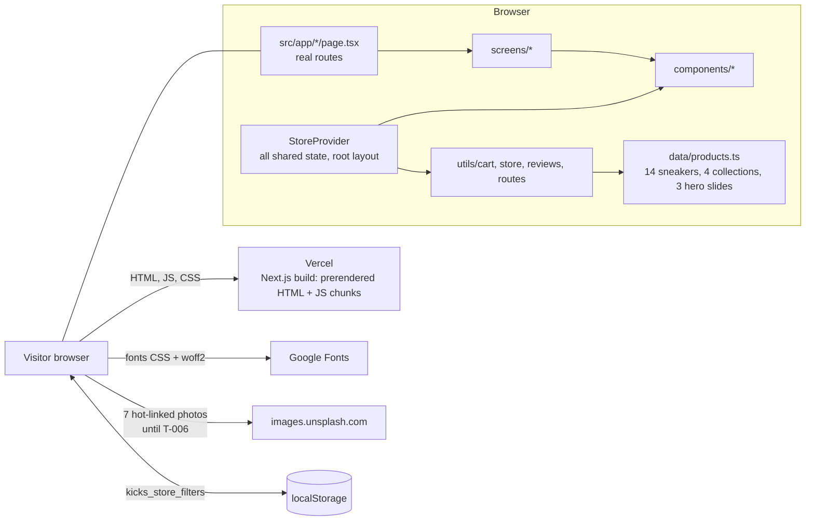

# Architecture — KICKS.

> First draft by setup-expert-v1 from the code. Owner: backend-expert-v1 (backend parts: there are none) and premium-ui-expert-v1 (frontend folder layout).

## Overview diagram (Mermaid)



There is no server, database, queue or third-party API. After the first load the app makes **zero** network requests.

## Folder structure

```
postcss.config.mjs    Tailwind v4 PostCSS plugin ('@' = repo root is set in tsconfig paths)
public/images/        5 product photos (served as /images/...)
public/assets/aistudio/   3 unused AI Studio images
src/
  app/                Next.js App Router
    layout.tsx        root layout: metadata, Google Fonts links, <StoreProvider>
    globals.css       @import "tailwindcss", font variables, scrollbar
    page.tsx, shop/, collections/, collections/[id]/, about/, contact/, account/
                      one page.tsx per route; each renders a component from screens/
  types/index.ts      Sneaker, CartItem, Review, CollectionCategory
  data/products.ts    SNEAKERS, CATEGORIES, HERO_SLIDES (static)
  lib/supabase.ts     browser Supabase client (null when the NEXT_PUBLIC_ vars are missing)
  utils/              pure logic + node:test files: cart, store, reviews, orders, routes
  screens/            Home, Shop, Collections, About, Contact, Account (one per route, 'use client').
                      Not src/pages: Next.js would read that as the Pages Router
  components/         StoreProvider (ALL shared state + header/footer/overlays around the route),
                      Header, Footer, Hero + home sections, ProductCard, SneakerVisual,
                      overlays: CartDrawer, WishlistDrawer, ProductDetailModal, CheckoutModal, AuthModal
```

## Modules

| Module | Job | Rule |
|---|---|---|
| `components/StoreProvider.tsx` | Client context provider in the root layout. Owns every piece of shared state (bag, wishlist, promo, drawers/modals, toast, Supabase user); defines cart and wishlist handlers and `navigate()`; renders Header, Footer, drawers and modals around the route's `children`; exposes `useStore()` | Add new shared state here (D-004 as amended by D-014) |
| `app/*/page.tsx` + `screens/*` | One route each: the `page.tsx` renders the matching screen. Screens are mostly presentational. `ShopPage` keeps its filters locally and mirrors them to `localStorage` | Screens read shared state and actions with `useStore()`; every screen starts with `'use client'` |
| `components/*` | Sections and overlays. Overlays are always mounted and return `null` when closed | Reset your own `useState` on open (B-02) |
| `utils/cart.ts` | `calculateCartTotals`, `validatePromoCode`, `formatPrice`; constants `FREE_SHIPPING_THRESHOLD = 150`, `STANDARD_SHIPPING_FEE = 15`, `TAX_RATE = 0.08` | Only place for money maths (D-010) |
| `utils/store.ts` | `filterAndSortSneakers`, `INITIAL_STORE_FILTERS` | Pure, tested |
| `utils/routes.ts` | `PageView`, `hrefFor`, `pageFromPathname`, `parseShopFilters`, `COLLECTION_IDS` | Only place that knows what a URL looks like; pure, tested |
| `utils/reviews.ts` | `calculateReviewStats`, `INITIAL_REVIEWS_SEED` (sample reviews for 3 sneakers) | Seed data is placeholder content (PRD Q-04) |
| `components/SneakerVisual.tsx` | Shows a product image by silhouette, falls back to inline SVG on error | Image paths: see B-04 |

Known structural facts that other code relies on: `SNEAKERS[2]` is assumed to be `jordan-4-retro` in `StoreProvider.tsx` and `HomePage.tsx` (B-05); a cart line is keyed by sneaker id + size + colour index.

## Data flow

1. User clicks (add to bag, heart, promo, filter) → a handler in `StoreProvider.tsx` calls `setState` → React re-renders → new context values and props reach screens and overlays.
2. Totals are never stored: `CartDrawer` and `CheckoutModal` call `calculateCartTotals(items, discountPercent)` on every render.
3. Navigation: real paths. `navigate(page, options)` in `StoreProvider` calls `router.push(hrefFor(page, options))`; the header highlight is `pageFromPathname(usePathname())`. Routes: `/`, `/shop`, `/collections`, `/collections/[id]` (`lifestyle`, `running`, `basketball`, `casual`; any other id is a 404), `/about`, `/contact`, `/account`. Shop pre-filters travel in the query string (`?collectionType=new-in|best-sellers|limited-edition`, `?category=Lifestyle|Running|Basketball|Casual`), validated by `parseShopFilters`. Old `/#shop`-style links land on home.
4. Persistence: only `ShopPage` filters (`localStorage` key `kicks_store_filters`; a filter in the URL wins, otherwise the saved ones apply). Bag, wishlist, promo and reviews added in the modal survive route changes (they live in `StoreProvider`) but are lost on reload.
5. Checkout: submit → random order number → `onOrderComplete` empties the bag. Nothing leaves the browser.

## Call map and request budget

| Screen / action | Network requests | Notes |
|---|---|---|
| First load (any page) | 1 prerendered HTML + several JS chunks + 1 CSS + Google Fonts CSS and font files + images | Sizes not measured since the Next.js move (the Vite build was one ~381 kB JS bundle). Local images come from `public/images`; 7 Unsplash photos |
| Every user action (add, filter, open drawer, checkout, contact form) | **0** | All client-side |
| API calls | **0** | No backend (D-001) |

- **Budget:** 0 API requests per screen and per action. A new `fetch`/`XMLHttpRequest`/`WebSocket` is a design change: needs the owner's OK and a DECISIONS.md entry.
- **Update mechanism:** none needed; nothing is live or shared between visitors.
- **Capacity:** every current route is prerendered static HTML, so Vercel's CDN carries the load. `capacity.mjs` was not run: there is no server to size and no rate limits to set.
- Task T-009 runs `call-map.mjs` and `security-scan.mjs` to confirm the zero-call claim.

## External services

| Service | Purpose | Sandbox / limits | Status |
|---|---|---|---|
| Google Fonts | Outfit, Plus Jakarta Sans, Space Mono | Public CSS, no key. Limits: none published for normal use (not researched: no web access in this run) | Keep; consider self-hosting if privacy or speed matters |
| images.unsplash.com | 7 hot-linked photos in `Hero`, `AboutSplit`, `CultureBanner`, `DiscountNewsletter`, `HigherStandardBanner` | Hot-linking is unreliable and leaks visitor IPs | Replace with local assets in T-006 |
| Payment provider, email, analytics | none | n/a | Out of scope (D-001) |
