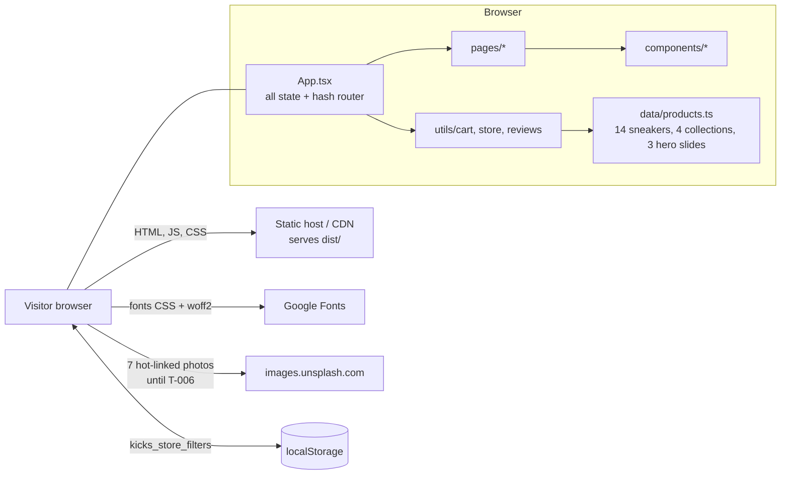

# Architecture — KICKS.

> First draft by setup-expert-v1 from the code. Owner: backend-expert-v1 (backend parts: there are none) and premium-ui-expert-v1 (frontend folder layout).

## Overview diagram (Mermaid)



There is no server, database, queue or third-party API. After the first load the app makes **zero** network requests.

## Folder structure

```
index.html            entry: meta tags, Google Fonts links, #root
vite.config.ts        react + tailwind plugins, '@' = repo root, DISABLE_HMR toggle (leave alone)
public/assets/aistudio/   3 unused AI Studio images
src/
  main.tsx            React root
  App.tsx             ALL state: page, bag, wishlist, promo, drawers/modals, toast; hash router
  index.css           @import "tailwindcss", font variables, scrollbar
  types/index.ts      Sneaker, CartItem, Review, CollectionCategory
  data/products.ts    SNEAKERS, CATEGORIES, HERO_SLIDES (static)
  utils/              pure logic + node:test files: cart, store, reviews
  pages/              Home, Shop, Collections, About, Contact (one per route)
  components/         Header, Footer, Hero + home sections, ProductCard, SneakerVisual,
                      overlays: CartDrawer, WishlistDrawer, ProductDetailModal, CheckoutModal
  assets/images/      5 product photos (referenced by '/src/assets/...' strings, see B-04)
```

## Modules

| Module | Job | Rule |
|---|---|---|
| `App.tsx` | Owns every piece of shared state; maps `location.hash` to a `PageView`; defines cart and wishlist handlers | Add new shared state here (D-004) |
| `pages/*` | One screen each; mostly presentational. `ShopPage` keeps its filters locally and mirrors them to `localStorage` | Receive data and callbacks as props |
| `components/*` | Sections and overlays. Overlays are always mounted and return `null` when closed | Reset your own `useState` on open (B-02) |
| `utils/cart.ts` | `calculateCartTotals`, `validatePromoCode`, `formatPrice`; constants `FREE_SHIPPING_THRESHOLD = 150`, `STANDARD_SHIPPING_FEE = 15`, `TAX_RATE = 0.08` | Only place for money maths (D-010) |
| `utils/store.ts` | `filterAndSortSneakers`, `INITIAL_STORE_FILTERS` | Pure, tested |
| `utils/reviews.ts` | `calculateReviewStats`, `INITIAL_REVIEWS_SEED` (sample reviews for 3 sneakers) | Seed data is placeholder content (PRD Q-04) |
| `components/SneakerVisual.tsx` | Shows a product image by silhouette, falls back to inline SVG on error | Image paths: see B-04 |

Known structural facts that other code relies on: `SNEAKERS[2]` is assumed to be `jordan-4-retro` in `App.tsx` and `HomePage.tsx` (B-05); a cart line is keyed by sneaker id + size + colour index.

## Data flow

1. User clicks (add to bag, heart, promo, filter) → a handler in `App.tsx` calls `setState` → React re-renders → new props reach pages and overlays.
2. Totals are never stored: `CartDrawer` and `CheckoutModal` call `calculateCartTotals(items, discountPercent)` on every render.
3. Navigation: `window.location.hash` ⇄ `currentPage` (`home | shop | collections | about | contact`; `collections/<id>` selects a category; unknown hashes show home). Shop pre-filters travel in `shopFilterOptions` state, not in the URL.
4. Persistence: only `ShopPage` filters (`localStorage` key `kicks_store_filters`). Bag, wishlist, promo and reviews added in the modal are lost on reload.
5. Checkout: submit → random order number → `onOrderComplete` empties the bag. Nothing leaves the browser.

## Call map and request budget

| Screen / action | Network requests | Notes |
|---|---|---|
| First load (any page) | 1 HTML + 1 JS (~381 kB, 106 kB gzip) + 1 CSS (~63 kB) + Google Fonts CSS and font files + images | Images: local ones are not bundled in production (B-04); 7 Unsplash photos |
| Every user action (add, filter, open drawer, checkout, contact form) | **0** | All client-side |
| API calls | **0** | No backend (D-001) |

- **Budget:** 0 API requests per screen and per action. A new `fetch`/`XMLHttpRequest`/`WebSocket` is a design change: needs the owner's OK and a DECISIONS.md entry.
- **Update mechanism:** none needed; nothing is live or shared between visitors.
- **Capacity:** only static files are served, so the host's CDN carries the load. `capacity.mjs` was not run: there is no server to size and no rate limits to set.
- Task T-009 runs `call-map.mjs` and `security-scan.mjs` to confirm the zero-call claim.

## External services

| Service | Purpose | Sandbox / limits | Status |
|---|---|---|---|
| Google Fonts | Outfit, Plus Jakarta Sans, Space Mono | Public CSS, no key. Limits: none published for normal use (not researched: no web access in this run) | Keep; consider self-hosting if privacy or speed matters |
| images.unsplash.com | 7 hot-linked photos in `Hero`, `AboutSplit`, `CultureBanner`, `DiscountNewsletter`, `HigherStandardBanner` | Hot-linking is unreliable and leaks visitor IPs | Replace with local assets in T-006 |
| Payment provider, email, analytics | none | n/a | Out of scope (D-001) |
