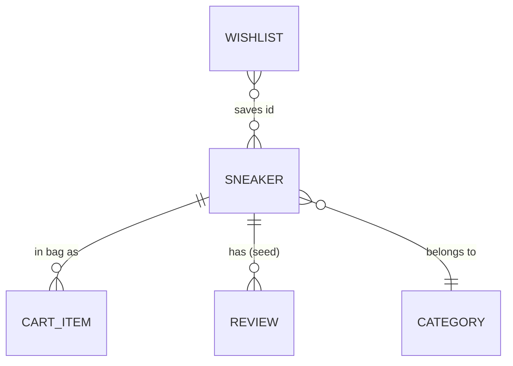

# Database schema — KICKS.

> First draft by setup-expert-v1 from the code. Owner: backend-expert-v1 (refines it if a backend is ever added).

**No database: the app stores nothing server-side because it has no server (D-001). Revisit if accounts, saved bags or real orders are added.** What follows is the in-code data model, so agents keep it consistent. Source of truth: `src/types/index.ts` and `src/data/products.ts`.

## Tables

Static data (TypeScript constants), not tables:

**`Sneaker`** (14 rows in `SNEAKERS`)

| Field | Type | Null | Default | Notes |
|---|---|---|---|---|
| id | string | no | | unique slug, e.g. `jordan-4-retro`; used as wishlist id and in the cart-line key |
| name, brand | string | no | | 7 brands: Nike, Jordan, New Balance, Adidas, Asics, Salomon, Converse |
| category | `'Lifestyle' \| 'Running' \| 'Basketball' \| 'Casual'` | no | | |
| collectionType | `'all' \| 'new-in' \| 'best-sellers' \| 'limited-edition'` | no | | preset views |
| price | number (USD) | no | | $110 to $390 today |
| originalPrice | number | yes | | strike-through price |
| rating, reviewsCount | number | no | | static display values, not computed from reviews |
| image, silhouette | string, union | no | | image path string (B-04); silhouette picks the fallback SVG |
| colors, colorwayNames | string[] | no | | hex swatches; **same length** |
| sizes | number[] | no | | US sizes, e.g. 7 to 13 |
| description, details | string, string[] | no | | |
| isNewArrival, isBestSeller, isLimitedDrop, tag, reviews | | yes | | flags and optional seed reviews |

**`CartItem`** (runtime state in `App.tsx`): `sneaker`, `selectedSize`, `selectedColorIndex`, `quantity`. Key = `sneaker.id` + size + colour index.
**`Review`**: `id, author, rating 1-5, date (text), title, comment, verifiedPurchase?, helpfulCount?`. Seed reviews exist for 3 sneakers (`utils/reviews.ts`); reviews written in the modal live in component state only.
**`CollectionCategory`** (4 in `CATEGORIES`): `id, name, itemCount, imageSilhouette, image?, bgColor, tagline`.

Browser storage: key `kicks_store_filters` = JSON of `StoreFilterState` (search, category, brand, size, min/max price, sort, collectionType).

## Relations

## Indexes

None. Lookups scan 14 items in memory. If the catalogue grows past a few hundred items, build an `id → Sneaker` map once.

## Constraints and concurrency rules

- `Sneaker.id` is unique; `colors.length === colorwayNames.length`; `price > 0`; every `HERO_SLIDES` entry and every id referenced in `App.tsx`/`HomePage.tsx` must exist in `SNEAKERS` (today they are index-based or duplicated: B-05, B-06). T-020 adds a test for all of these.
- Money is in dollars with two decimals, rounded in `utils/cart.ts` only.
- Concurrency: the browser is single-threaded, so there are no races between visitors. The real hazard is **double submit** (two clicks on "Place order" produce two order numbers): guard it in T-004.
- If money or stock ever move to a server: atomic conditional updates in a transaction and idempotency keys (backend-expert-v1 defaults).

## Migrations and backups

No migrations. A change to `StoreFilterState` must tolerate old saved JSON: merge over `INITIAL_STORE_FILTERS` (already done) and ignore unknown or invalid values (T-022 tests a tampered value). Backups: the git history is the only copy of the data.
